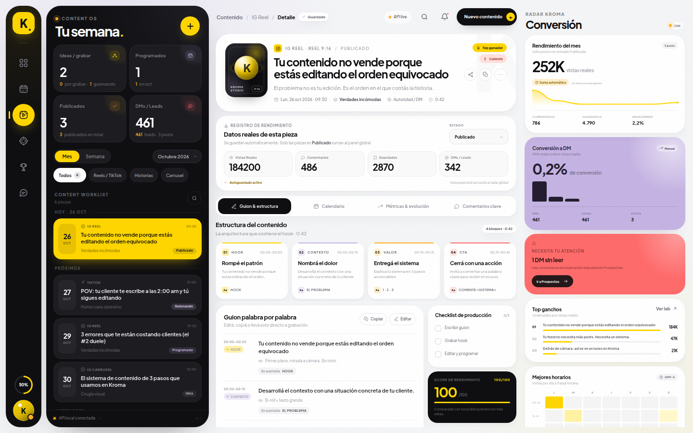
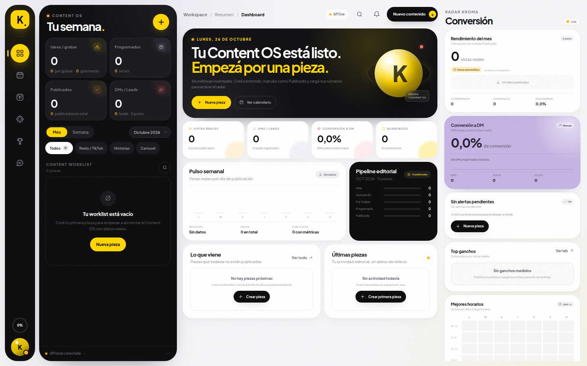
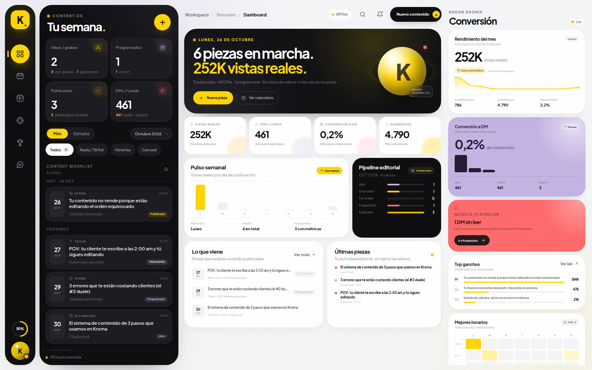
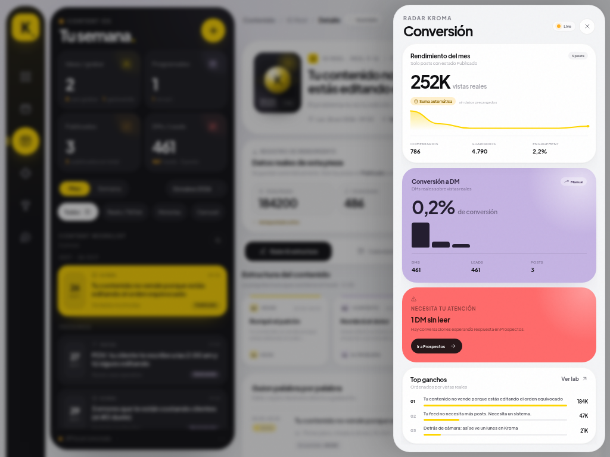
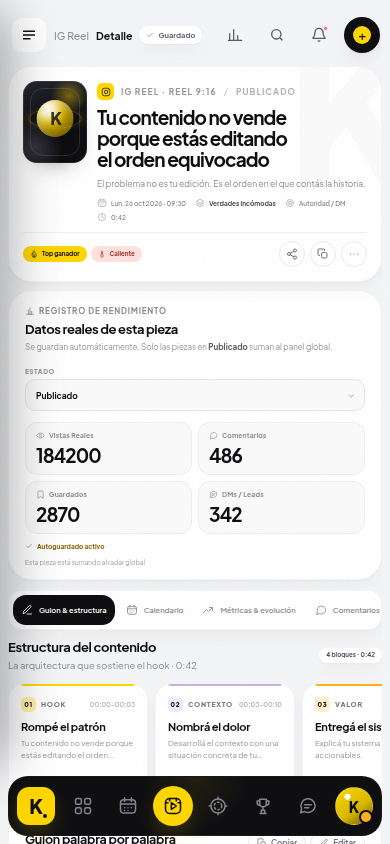
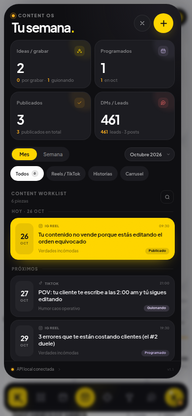

# Kroma Studio · Content OS

Content CRM, calendario editorial y analítica de conversión para Instagram, TikTok e Historias.

La app arranca **vacía**: sin posts, prospectos, hooks ni métricas de ejemplo. Todo lo que ves se calcula con el contenido que creás y con los datos que cargás manualmente en el **Registro de rendimiento**.



> Las capturas de detalle muestran una pieza de ejemplo cargada para ilustrar el CRM. El estado inicial real es cero.

### Estado inicial



---

## Arrancar

Requiere **Node.js 18+**. No tiene dependencias externas ni build step.

```bash
cd "crm kroma"
npm start
```

Abrí **http://127.0.0.1:4173**.

```bash
npm run dev     # servidor con --watch
npm run check   # valida sintaxis de JS
```

---

## Reglas de datos reales

### Estado inicial vacío

`data/db.json` se crea desde `seed.js` con:

```json
{
  "posts": [],
  "prospects": []
}
```

El esquema tiene versión `2`. Si el servidor encuentra una base anterior (por ejemplo, con datos demo), la reemplaza automáticamente por el estado vacío.

### KPIs calculados en vivo

No hay números de métricas escritos en el código. Los globales salen de `globalMetrics()`:

```js
posts
  .filter(post => post.status === 'Publicado')
  .reduce((total, post) => {
    total.views += post.metrics.views;
    total.comments += post.metrics.comments;
    total.saves += post.metrics.saves;
    total.dms += post.metrics.dms;
    return total;
  }, { views: 0, comments: 0, saves: 0, dms: 0 });
```

Ese resultado alimenta:

- `DMs / Leads` del panel izquierdo.
- `Rendimiento del mes` del radar derecho.
- `Conversión a DM` = DMs / vistas.
- KPIs del dashboard, engagement, top de ganchos, heatmap de horarios y alertas.

Los posts en `Idea`, `Guionando`, `Por Grabar` o `Programado` **no suman** hasta cambiar su estado a `Publicado`.

### Registro de rendimiento por post

En el detalle de cada pieza hay un panel editable con:

| Campo | Tipo |
| --- | --- |
| Vistas Reales | `input[type=number]` |
| Comentarios | `input[type=number]` |
| Guardados | `input[type=number]` |
| DMs / Leads | `input[type=number]` |

El guardado es automático (debounce de 450 ms) y persiste en la API. Los campos actualizan el panel global **mientras escribís**, sin recargar.

Dropdown de estado:

`Idea` → `Guionando` → `Por Grabar` → `Programado` → `Publicado`

Al seleccionar `Publicado` con valores cargados, la pieza entra inmediatamente en la suma global.

---

## Sistema visual

| Token | Valor |
| --- | --- |
| Amarillo Kroma | `#FFD600` |
| Carbón | `#0F0F12` |
| Tarjeta oscura | `#1C1C21` |
| Canvas | `#F4F5F7` |
| Lavanda | `#C5B4E3` |
| Coral | `#FF6B6B` |
| Ámbar de apoyo | `#FFB020` |
| Tipografía | Plus Jakarta Sans local, variable 200–800 |
| Radios | 30px contenedores · 24px tarjetas · 18px internas · full en píldoras |

Se eliminaron los tonos lima/verde fluorescente. El acento de marca, los botones principales, el logo, los iconos activos y la tarjeta seleccionada usan `#FFD600`. La tarjeta activa del worklist se pinta completa en amarillo con texto negro.

---

## Vistas

- **Dashboard:** KPIs reales, pulso semanal, pipeline por estado, próximas piezas y últimas publicaciones.
- **Calendario:** grid mensual, estados por color y mejores ventanas calculadas desde posts publicados.
- **Reels / TikTok:** detalle del contenido, guion editable, checklist, CTA, métricas y comentarios.
- **Historias:** storyboard 9:16 generado desde la pieza, secuencia y rendimiento real.
- **Hook lab:** ranking derivado de las vistas reales de cada post.
- **Prospectos:** bandeja de DMs, pipeline, creación de prospectos y conversión.
- **Radar Kroma:** rendimiento de publicados, conversión, top de ganchos, heatmap y alertas calculadas.

### Interacciones
- Crear, duplicar y editar guiones.
- Cambiar estado de una pieza.
- Registrar métricas por post.
- Comentar, responder y dar me gusta.
- Crear prospectos y enviar DMs.
- Filtrar por mes, semana, canal y búsqueda.
- Drawer de analítica en pantallas medianas y cola móvil.

---

## API local

### ¿Cómo arreglo la API?

La API ya viene incluida y no requiere claves.

1. Comprobá que esté viva:

   ```bash
   curl http://127.0.0.1:4173/api/health
   ```

   Debe devolver `{"ok":true,...}`.

2. Si no responde:

   ```bash
   cd "crm kroma"
   npm start
   ```

3. Si el puerto está ocupado:

   ```bash
   PORT=4174 npm start
   ```

   PowerShell:

   ```powershell
   $env:PORT=4174; npm start
   ```

4. En la interfaz abrí **«API live»** (topbar), el pie del panel oscuro o **Cuenta → Estado de la API**. Allí podés probar la conexión y ver el diagnóstico.

5. Si los datos se corrompen, borrá `data/db.json` y reiniciá el servidor. También podés usar **Estado de la API → Borrar todos los datos** o:

   ```bash
   curl -X POST http://127.0.0.1:4173/api/reset
   ```

6. Instagram y TikTok **no están conectados**: el registro es manual. Para leer métricas reales necesitás crear una app en Meta/TikTok, permisos de insights y OAuth. No se puede resolver solo con una clave; la app está preparada para funcionar sin esa integración.

### Endpoints

| Método | Ruta | Descripción |
| --- | --- | --- |
| `GET` | `/api/health` | Estado, uptime y cantidad de piezas |
| `GET` | `/api/state` | Dataset completo |
| `POST` | `/api/posts` | Crea una pieza |
| `GET` | `/api/posts/:id` | Obtiene una pieza |
| `PATCH` | `/api/posts/:id` | Edita guion, estado, métricas, checklist, CTA |
| `DELETE` | `/api/posts/:id` | Elimina una pieza |
| `POST` | `/api/posts/:id/duplicate` | Duplica como idea |
| `POST` | `/api/posts/:id/comments` | Añade comentario |
| `POST` | `/api/prospects` | Crea un prospecto |
| `PATCH` | `/api/prospects/:id` | Cambia etapa, valor o no leídos |
| `POST` | `/api/prospects/:id/messages` | Envía un DM |
| `POST` | `/api/reset` | Deja la app en cero |

---

## Estructura

```text
crm kroma/
├─ server.js              API HTTP + servidor estático
├─ seed.js                estado inicial vacío
├─ package.json
├─ data/
│  └─ db.json             persistencia local atómica
├─ public/
│  ├─ index.html           shell Bento de 4 columnas
│  ├─ styles.css           sistema visual + responsive
│  ├─ app.js               estado, KPIs dinámicos, vistas e interacciones
│  └─ assets/              favicon + Plus Jakarta Sans local
└─ docs/                   capturas
```

---

## Capturas

| Dashboard | Radar de conversión |
| --- | --- |
|  |  |

| Mobile | Cola móvil |
| --- | --- |
|  |  |

---

## Límites conocidos

- Persistencia JSON local para una sola marca / operador.
- Sin autenticación multiusuario.
- Sin publicación automática ni OAuth de redes.
- Los datos de rendimiento se cargan manualmente; no se inventan ni se simulan.
